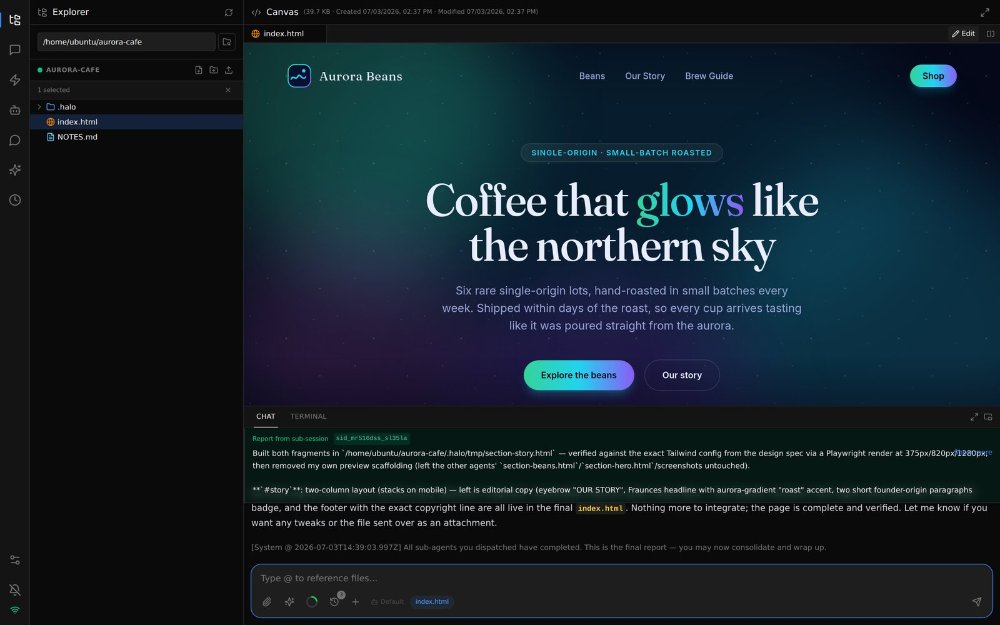
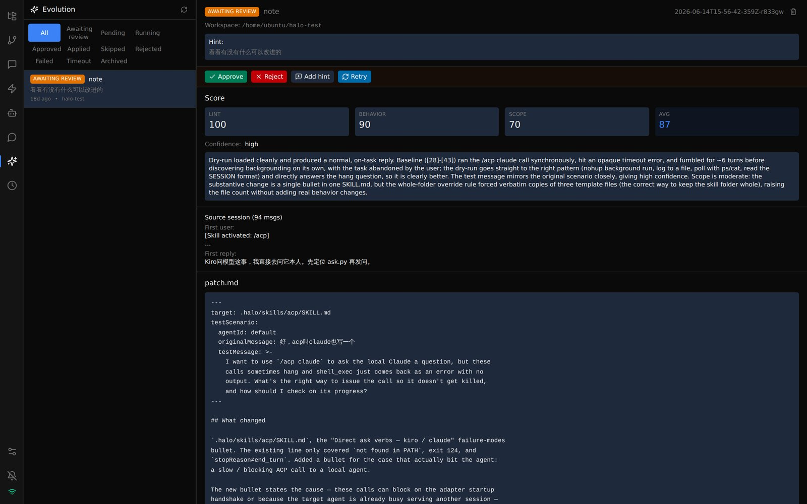
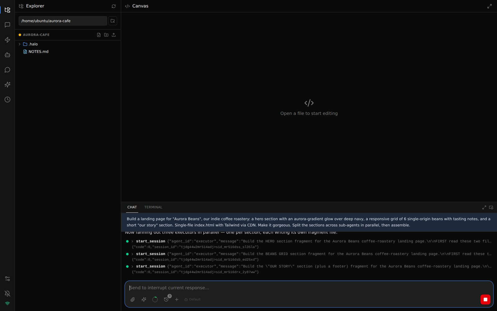
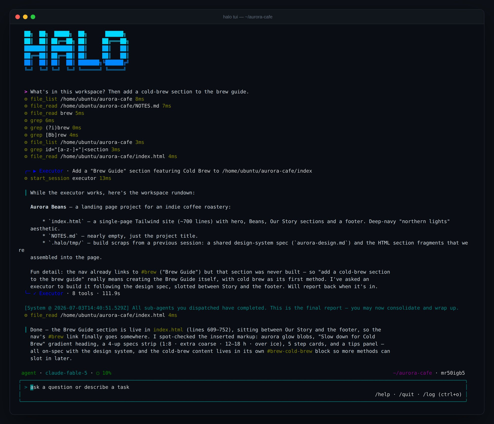
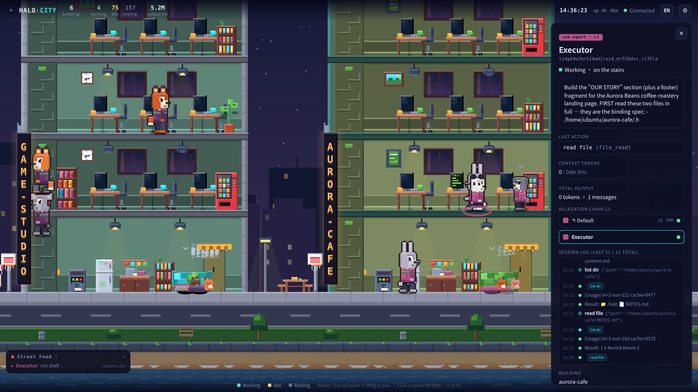

# Halo

[](https://www.npmjs.com/package/@turmind/halo)
[](LICENSE)
[](https://nodejs.org)

[English](README.md) | [中文](README.zh-CN.md)

**扔进去一个想法，一支 Agent 团队把它做出来。**

一支自托管的 AI Agent 团队，就在你的项目文件夹里干活。用你自己的模型 key，在浏览器、Slack、Telegram 或终端里指挥它。主 Agent 拆解任务、并行派发给子 Agent；每次工具调用都实时可见，你随时可以打断、纠偏、亲自上手。团队的所有知识和产出都是工作区里的普通文件 —— 没有隐藏记忆，没有黑盒状态。


<p align="center"><sub>一句话 ——「给我们的咖啡烘焙坊做个落地页……各节拆给子 Agent 并行做，最后组装」。Executor 们并行开工、逐个汇报，拼好的页面直接在 Canvas 里预览，全程一个浏览器标签页。</sub></p>

## 安装

Halo 支持 Linux（x64 / arm64）、macOS 和 Windows，需要 **Node.js 22+**。Ubuntu 24.04 自带的 `nodejs` 是 18，跑不起来（`halo` 会拒绝启动），所以先装 22：

```bash
curl -fsSL https://deb.nodesource.com/setup_22.x | sudo -E bash - && sudo apt-get install -y nodejs   # Ubuntu / Debian
brew install node@22           # macOS（keg-only：按 brew 的提示加进 PATH）
nvm install 22                 # 用 nvm（或：fnm install 22）
```

```bash
npm install -g @turmind/halo   # 一个二进制，全部子命令
halo setup                     # 交互式：密码 / 端口 / 模型 key / 可选技能
halo server start              # → 打开 http://localhost:9527
```

任意一家模型 key 就能跑 —— Anthropic、OpenAI（或任何 OpenAI 兼容端点）、Gemini、DeepSeek、Kimi、Qwen……**不需要** AWS 账号，Bedrock 只是[其中一个 provider](#模型)（而且可以不填 key，直接走 AWS 凭证链）。

- **`sudo`**：系统级 Node（apt / NodeSource 装的）执行 `npm install -g` 要加 `sudo`；用 nvm / fnm 则不用。
- **`halo setup` 里**：问到 *Configure model provider keys now?* 时选 **Configure…**（默认项）。选好 provider、粘贴 key，再选 **── Done**（列表最后一项，按 ↑ 可以直接绕到它），最后在 *Switch default agent to …* 上回车。
- **远程主机上**：用 `halo server start -d`（不加 `-d` 会留在前台，SSH 一断就退出；在带 systemd 的 Linux 上，`-d` 会装成开机自启的用户服务），再用 `ssh -L 9527:localhost:9527 user@host` 建隧道，在本机打开 `http://localhost:9527`。不要在安全组里放开 9527 —— 见[现状与局限](#现状与局限)。
- **Linux 沙箱**：`workspace` / `readonly` 访问级别需要 `sudo apt install bubblewrap`，Ubuntu 23.10+ / 24.04 还要加上 [AppArmor profile](.halo/docs/dev/deploy.md#bubblewrap-on-ubuntu-2310-and-2404-apparmor)。缺了它，server 启动时会给出警告和修法，`/api/health` 显示 `sandbox: null`，非 full 会话无法执行 shell。
- **升级**：`halo upgrade && halo server restart`。由 systemd 托管的 server 会通过 `systemctl` 重启；system unit（见 [deploy.md Option C](.halo/docs/dev/deploy.md#option-c-systemd-for-the-npm-install)）可能需要 `sudo systemctl restart halo`。内置文档、Agent 和技能会在下次启动时自动刷新。
- **Docker / CI**：`halo setup --non-interactive`，同时设好 `HALO_DEFAULT_PROVIDER=deepseek` 和 `DEEPSEEK_API_KEY`，就会绑定内置 Agent，并把 key 的占位符 `<<DEEPSEEK_API_KEY>>`（不是 key 本身）写进 `~/.halo/secrets/settings.yaml`；server 运行时也要设着这个变量（见 [deploy.md](.halo/docs/dev/deploy.md#non-interactive-docker--ci-details)）。`HALO_PASSWORD` 只是*管理台*密码。
- **源码构建**：`pnpm install && pnpm build`（pnpm 11）。

**桌面版**：[GitHub releases](https://github.com/turmind/halo-agent/releases) 里有 Windows x64 `.exe` 和 macOS（Apple Silicon）`.dmg`（不一定每个版本都两样齐全），内置 server、管理台和独立的 Node 运行时 —— 不需要 `npm`，`~/.halo/` 数据一致，以后可以随时切换。安装包未签名（macOS 提示「已损坏」→ `sudo xattr -dr com.apple.quarantine /Applications/Halo.app`；Windows 上 SmartScreen 可能会拦一下）。

> [!IMPORTANT]
> **第一条消息就报 `Could not load credentials from any providers`？** 内置 Agent 出厂指向 AWS Bedrock，而 `halo setup` 里 *"Bind the default agent to a provider you just configured?"* 这一步被跳过了。重跑一次 `halo setup` —— 它会改绑所有内置 Agent，包括 `/evo` 用的内部 Agent —— 或在 **Agents → default** 里把 model provider 切过去。
>
> **在带实例角色的 EC2 / ECS 上不会报错**：没绑定的安装会悄悄改用该 AWS 账号上的 Bedrock Claude。可以看 `halo cli -v "hi"` 输出末尾的模型名，或在 **Agents → default** 里确认。

## 为什么是 Halo

### 🧬 它会改写自己的提示词 —— 而你审核这份 diff

Halo 从自己的对话里学习。执行 `/evo`（或 pre-compact 自动触发）：内置进化 Agent 分析本次会话、起草一份针对工作区提示词文件的补丁、在沙箱里用原始场景对打过补丁的 Agent 做 dry-run，再由打分 Agent 评定效果。你在 **Evolution** 标签页通过或驳回；通过的补丁合并回工作区。是你亲自审核的真实文件 diff —— 不是悄悄发生的微调。


<p align="center"><sub>一条真实的待审核记录：lint / behavior / scope 三项分数、打分 Agent 的评语、补丁本体 —— 点一下就合并进工作区。</sub></p>

### 📁 整支 Agent 团队就是一个文件夹

人设、技能、知识、会话历史 —— 整个团队都以普通文件的形式住在 `.halo/` 里：

```
my-project/
├─ .halo/
│  ├─ agents/     # 团队成员 —— 每个 Agent 的人设、模型、工具
│  ├─ skills/     # 会做什么 —— Markdown 技能，按需注入
│  ├─ docs/       # 学到了什么 —— Agent 读写的知识库
│  ├─ memory/     # 按日期记录的决策笔记
│  └─ sessions/   # 每一次对话，可回放
└─ src/ …         # 你真正的项目
```

把 `.halo/` 和代码一起提交，克隆的人就拿到同样的 Agent、技能和知识 —— 是真实文件本身，不是导出物（模型 key 由对方自备）；`/workspace share` 则把配置打成 zip，不含会话、记忆和密钥。从 Halo 的源代码管理面板初始化仓库时，会写好一份 `.gitignore`，排除会话、日志、`tmp/` 和数据库；已有的仓库需要自己加上这几项，另外别把真实 key 写进 `.halo/settings.yaml`（用 `<<ENV>>` 占位）。

### 🌐 一个工作区，所有屏幕

在浏览器里开工，地铁上用微信看进度，Telegram 或 Slack 里补一句需求，最后在终端里收尾。所有渠道连的都是*同一个*工作区 —— 渠道只是门，工作区才是房间；full 级账号还能用 `/session switch` 接上在别处开的对话。

<p align="center">
  
  &nbsp;&nbsp;
  
</p>
<p align="center"><sub>同一个工作区，在手机微信和 Telegram 上无缝续聊。</sub></p>

### 👁 看着它思考

主 Agent 的推理、每次工具调用（包括子 Agent 的）、每处文件改动都实时可见；子 Agent 的完整日志在 **Sessions** 标签页里打开。打断是优雅的（对话修复，而非硬杀进程），子 Agent 完工自动汇报。你始终在环内，而不是「跑起来听天由命」。


<p align="center"><sub>主 Agent 并行拉起三个 executor —— 每个 <code>start_session</code>、每次工具调用都即时可见。</sub></p>

## 开箱即有

- **按 Agent 选模型** —— 每个 Agent 各自选 provider 和模型：重活给 Bedrock 上的 Claude，例行子任务给便宜的模型，零代码改动。
- **IDE 级管理台** —— 聊天 + Monaco 编辑器 + 文件树 + Git 面板 + 终端（xterm.js），一个浏览器标签页全搞定，四套主题可选。
- **技能和 Agent 都是文件** —— 技能是按需注入的 Markdown，Agent 是一份人设加一个 `agent.yaml`。工作区级或全局，不用写代码。
- **预览扩展** —— 给编辑器装的查看器和小应用：3D 模型、draw.io、Excalidraw、Jupyter 笔记本、会议录音等，来自 [halo-hub](https://github.com/turmind/halo-hub)。用 `/extension install <id>` 安装，或在 **Settings → Extensions** 上传 zip（[设计](.halo/docs/design/canvas-extensions.md)）。
- **Cron 定时任务** —— 定时（循环或一次性）跑 Agent，产出自动分发到绑定的聊天渠道。
- **访问级别** —— 每个会话 `full` / `workspace` / `readonly` 三级，由 OS 沙箱强制执行（Linux 用 bubblewrap，macOS 用 Seatbelt）；子 Agent 的权限永远不会超过父会话（[级别怎么定](.halo/docs/guide/delegation-and-access.md#5-access-levels)、[局限](#现状与局限)）。
- **结构化会话** —— 父子层级会话、异步协同、完工自动汇报。
- **跨出单个工作区** —— 把活 [relay](.halo/docs/design/relay.md) 给同一台服务器上的另一个工作区，用 [A2A v1.0](.halo/docs/design/a2a.md) 和其他 Agent 服务器对话，或用 `halo agentcore` 作为 Amazon Bedrock [AgentCore](.halo/docs/design/agentcore.md) Runtime 无界面运行。
- **可观测性** —— 填一个 OTLP 端点，traces、metrics、logs（遵循 GenAI 语义约定）就会发往任意 OpenTelemetry collector；`/api/metrics` 提供 Prometheus 指标（[设计](.halo/docs/design/observability.md)）。

## 模型

按 Agent 配置，走同一套 provider 无关的运行时。AWS Bedrock Claude 是第一优先目标，其余同为一等公民。`/extension models` 可以从 hub 拉取最新的 provider 配置，不用等 Halo 发版。

| Provider | 说明 |
|---|---|
| **AWS Bedrock Claude** | 主力 —— Bedrock Invoke API |
| AWS Bedrock Mantle | 经 Bedrock 使用 OpenAI GPT 系模型 |
| AWS Bedrock OpenAI 兼容接口 | 经 bedrock-runtime 的 OpenAI Responses API 使用 GPT、Grok、Kimi、GLM 等模型 |
| Anthropic | 官方直连 API |
| OpenAI | 直连 / 任意 OpenAI 兼容端点 |
| DeepSeek | |
| Kimi（月之暗面） | |
| MiniMax | |
| Mimo（小米） | Anthropic 兼容网关，1M 上下文 |
| Qwen（阿里云） | |
| Hunyuan（腾讯混元） | |
| Doubao（火山引擎豆包） | |
| 智谱 AI（GLM） | GLM-5.3 系列，Flash 型号支持图片 |
| Google Gemini | Gemini API（OpenAI 兼容端点）—— 3.8 Flash、3.5 Flash-Lite |


## 渠道

Telegram、Slack、飞书、企业微信和微信都是主动向外连接 —— 不需要公网地址，也不用开端口。新建的渠道账号默认是 `readonly`；谁能跟机器人对话，各渠道的[接入指南](.halo/docs/guide/channels/)里都写明了。

| 渠道 | 传输 | 说明 |
|---|---|---|
| **Admin** | WebSocket | 全功能浏览器管理台 |
| **Web** | HTTP + SSE | Token 鉴权 API，可独立部署 —— 见 [curl 示例](#用-curl-直接对话) |
| **CLI / TUI** | 本地 | 独立终端客户端，内嵌 Agent 循环（无需服务器） |
| **Telegram** | Bot API | 长轮询 |
| **Slack** | Socket Mode | 无需公网 webhook |
| **飞书 / Lark** | 长连接 | `appId` + `appSecret` |
| **企业微信** | 长连接 | `botId` + `secret`（智能机器人，无 HTTP 发送接口） |
| **微信** | 扫码绑定 | 手机扫码即用 |
| **ACP 适配器** | stdio JSON-RPC | `halo acp` 把 ACP 编辑器（Zed、JetBrains IDE）桥接到 Web 渠道 —— [指南](.halo/docs/guide/channels/acp.md) |


<p align="center"><sub>TUI 在你的终端里跑同一套 Agent 循环 —— 图中正委派 executor 干活并汇总其报告，全程无需服务器。</sub></p>

### 用 curl 直接对话

Web 渠道是一个 token 鉴权的 HTTP + SSE 端点，给你自己的 UI 或脚本用。在管理台打开 **Channels → Web → Add Account**，选好工作区和访问级别，复制 token（只显示一次）。然后：

```bash
curl -N -H "x-token: $TOKEN" -H "Content-Type: application/json" \
  -d '{"message":"这个工作区里有什么文件？"}' \
  http://localhost:9527/api/web/chat
```

响应是 SSE 帧 —— `session` / `thinking` / `tool_call` / `stream` / `complete` —— 完整协议见 [`.halo/docs/guide/channels/web.md`](.halo/docs/guide/channels/web.md)。

## Halo City

一座只读的像素之城，实时可视化一台 halo 服务器：每个工作区是一栋楼，每个会话是一只动物市民 —— 干活时伏案敲键盘，闲下来喝咖啡、打街机。点击任意市民，看到的是真实数据：实时会话日志、委派链、最近一次工具调用、token 用量。纯客户端 canvas，只轮询一个接口 —— **零模型 token 消耗**。代码在 [`halo-city/`](halo-city/)（纯静态文件，无需构建）—— 设计笔记见 [design/halo-city.md](.halo/docs/design/halo-city.md)。


<p align="center"><sub>街景视角：<code>aurora-cafe</code> 楼里三只子 Agent 市民埋头干活；检查面板里是其中一个 executor 的实时日志和委派链。</sub></p>

## 技术栈

- **Monorepo**：pnpm workspace（`core`、`server`、`admin`、`cli`、`desktop`、`acp-adapter`）
- **后端**：Hono + WebSocket，单个 Node.js 22+ 进程，端口 9527（ESM，TypeScript strict）
- **前端**：Next.js 15 静态导出，由 Hono 直接托管
- **Agent**：自研编排循环，provider 无关的 `ModelRuntime` 接口
- **存储**：SQLite + Drizzle ORM —— 不需要额外拉起任何外部服务

## 文档

- [`.halo/INDEX.md`](.halo/INDEX.md) —— 项目总览 + 文档索引
- [`.halo/docs/guide/`](.halo/docs/guide/README.md) —— 用户指南
- [`.halo/docs/requirements/overview.md`](.halo/docs/requirements/overview.md) —— 产品概念
- [`.halo/docs/design/architecture.md`](.halo/docs/design/architecture.md) —— 后端架构
- [`.halo/docs/design/evolution.md`](.halo/docs/design/evolution.md) —— 自进化设计
- [`.halo/docs/guide/channels/`](.halo/docs/guide/channels/) —— 各渠道接入指南
- [`.halo/docs/dev/deploy.md`](.halo/docs/dev/deploy.md) —— 部署（systemd / Nginx）
- [`.halo/docs/dev/env.md`](.halo/docs/dev/env.md) —— 环境变量、构建命令
- [`CHANGELOG.md`](CHANGELOG.md) —— 每个版本的变更
- [`CLAUDE.md`](CLAUDE.md) —— 面向 Claude Code 的开发说明

## 现状与局限

Halo 还年轻 —— 请把它当早期项目看待：

- **沙箱守的是写入和凭证，不是网络。** 在 `workspace` / `readonly` 会话里，bubblewrap（Linux）或 Seatbelt（macOS）把写入限制在工作区和临时目录（`readonly` 只剩临时目录），并屏蔽 `~/.halo/secrets`、`~/.ssh`、`~/.aws` 等路径；主机上其余内容仍然可读，对外连接也照常可用。威胁模型是「可信 Agent 的误操作与路径逃逸」—— 不是关住恶意技能或扩展，也拦不住被提示注入的会话把它能读到的东西发出去。
- **Windows 宿主机上没有沙箱。** 在那里，`workspace` 会话实际等同于 `full`，`readonly` 也能读到 halo 进程可读的任何路径 —— 别在 Windows 宿主机上发放非 `full` 的渠道 token 并指望它有隔离效果（[dev/tools.md](.halo/docs/dev/tools.md)）。
- **管理台是单租户的，走明文 HTTP，监听所有网卡。** 只有一个密码（同一 IP 连续 5 次登录失败会被锁 15 分钟）；拿到管理台 cookie 的人就控制了整台服务器 —— 所有工作区、以服务用户身份执行 shell、每个渠道的凭证。请把 9527 端口放在防火墙、VPN 或 SSH 隧道后面，或放在带 TLS 的反向代理后面（[deploy.md §10](.halo/docs/dev/deploy.md#10-optional-nginx-reverse-proxy)）；给别人用请开渠道账号、设各自的访问级别，而不是共享管理台登录。
- **测试停留在单测/回归层。** 每次 push 和向 `main` 提 PR 时由 CI 跑一遍；还没有端到端或集成测试。
- **API 和磁盘格式在版本间仍可能变化。** 还在打磨阶段，会有毛边。

碰到坏掉或奇怪的行为，请开 issue —— 现阶段的早期反馈真的很有用。安全问题请按 [SECURITY.md](SECURITY.md) 私下报告。

## 参与贡献

欢迎提 PR 和 issue —— [CONTRIBUTING.md](CONTRIBUTING.md) 写了构建 / 测试 / 提交规范，以及动手前值得知道的两个打包坑。所有参与者请遵守[行为准则](CODE_OF_CONDUCT.md)。

## 许可证

MIT
